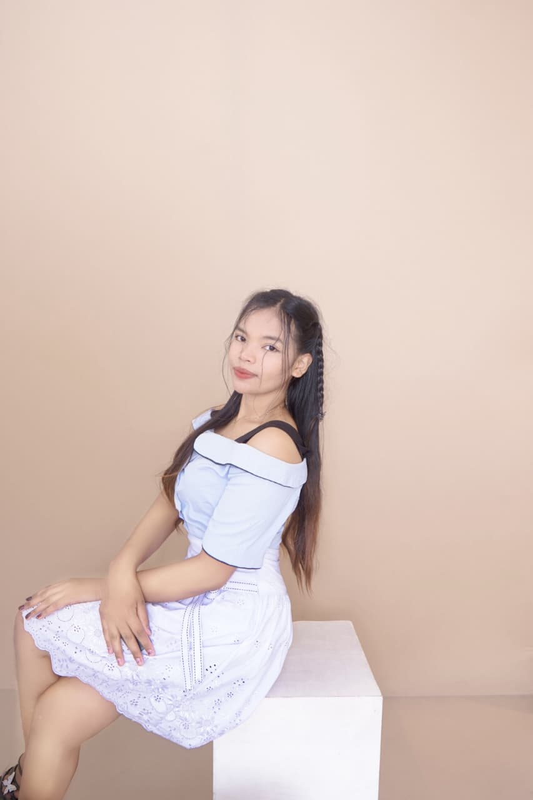

  

<h2 align="center">🎀 ✧ Hai, aku Tiwy! ✧ 🎀</h2>

  

  
  
  

  

## 🌷 Tentang Saya

<table align="center">
  <tr>
    <td>🎓 <b>Kampus</b></td>
    <td>Universitas Sumatera Utara</td>
  </tr>
  <tr>
    <td>📚 <b>Prodi</b></td>
    <td>D3 Teknik Informatika</td>
  </tr>
  <tr>
    <td>💻 <b>Fokus</b></td>
    <td>PHP &amp; Web Development</td>
  </tr>
  <tr>
    <td>🌱 <b>Lagi dipelajari</b></td>
    <td>Backend, Database, dan bikin web yang cantik</td>
  </tr>
  <tr>
    <td>🤝 <b>Terbuka untuk</b></td>
    <td>Kolaborasi, diskusi, dan belajar bareng</td>
  </tr>
  <tr>
    <td>💌 <b>Sapa aku di</b></td>
    <td><a href="https://instagram.com/dwy_slbn">Instagram @dwy_slbn</a></td>
  </tr>
</table>

  

## 🛠️ Tech Stack

  
  
  
  
  

### 🧰 Tools

  
  
  
  

### 🌸 Progress Belajar

  
   
  
   
  
   
  
   
  

  

## 📊 GitHub Stats

  
  

  

  

<!--
  OPSIONAL - Snake contribution animasi (aktifkan setelah GitHub Action snake jalan, hapus tanda komentar ini)

  

-->

  

## 🎯 Target Belajar

- [x] Dasar HTML &amp; CSS ✨
- [x] Dasar PHP 🐘
- [ ] CRUD dengan PHP &amp; MySQL 💾
- [ ] Bikin website portofolio sendiri 🌸
- [ ] Belajar framework (Laravel) 🚀
- [ ] Kontribusi ke proyek open source 💗

  

## 💌 Kontak

  
  

  

  

